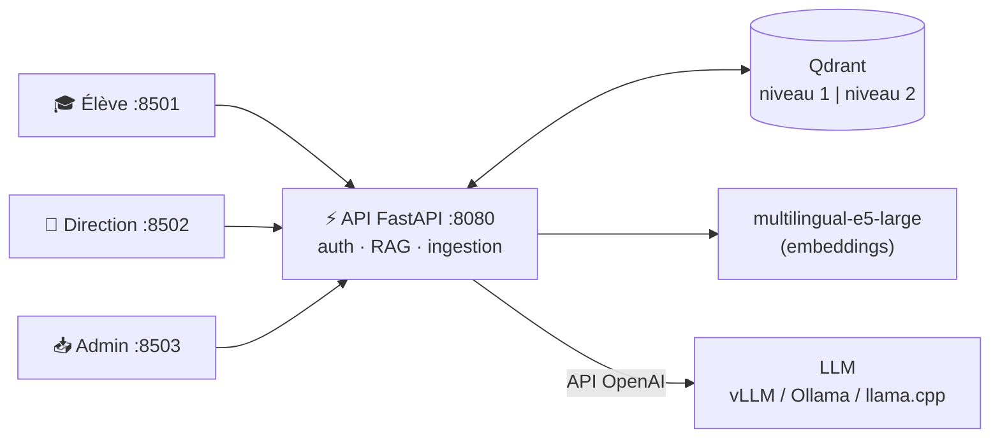

<h1 align="center">🎓 RAG École</h1>

<p align="center">
  <strong>Assistant documentaire pour établissements scolaires, fondé sur le RAG (Retrieval-Augmented Generation),<br/>
  avec des niveaux d'accès stricts entre élèves et direction, et une exécution 100 % locale.</strong>
</p>

<p align="center">
  <a href="https://github.com/DHoudetot-Cyril/RAG/actions/workflows/ci.yml"></a>
  
  
  
  
  
</p>

---

Les élèves posent leurs questions (« Dans quel délai justifier une absence ? », « Quand a lieu le stage ? »)
et obtiennent une réponse **rédigée et sourcée**, construite uniquement à partir des documents officiels.
La direction dispose de son propre espace, avec accès aux documents internes, **qu'aucun élève ne peut atteindre**.

## ✨ Fonctionnalités

- **💬 Chat en langage naturel** avec réponse en streaming et **citations numérotées** `[1]`, `[2]` renvoyant
  au document, à la page et à l'extrait utilisés.
- **🔐 Deux niveaux d'accès isolés** : une collection vectorielle par niveau et une clé d'API par rôle
  (élève / direction / administration). Un élève ne peut ni interroger, ni lister les documents internes.
- **🚫 Anti-hallucination** : sans passage suffisamment pertinent, l'assistant répond « information introuvable »
  **sans même appeler le LLM**.
- **📄 Ingestion multi-formats** : PDF, Word (`.docx`), PowerPoint (`.pptx`), texte et Markdown, avec numéros de page
  et de diapositive.
- **♻️ Ingestion idempotente** : empreinte SHA-256 par document. Ré-importer un fichier inchangé ne fait rien,
  une nouvelle version remplace l'ancienne, sans aucun doublon.
- **🗂️ Gestion documentaire** : upload multiple, catalogue par niveau, suppression avec confirmation.
- **🔌 LLM interchangeable** : n'importe quel serveur compatible OpenAI (vLLM sur GPU, Ollama ou llama.cpp sans GPU,
  ou une API distante).
- **🧪 Qualité** : 43 tests automatisés (sans GPU, en ~1 s), lint `ruff` et CI GitHub Actions, plus un script
  d'**évaluation** de la recherche (Hit@k, MRR, contrôle d'isolation).

## 🏗️ Architecture



| Service | Technologie | Rôle | Port |
|---|---|---|---|
| `backend` | FastAPI | API REST : authentification, RAG, ingestion | `8080` |
| `qdrant` | Qdrant | Base vectorielle, une collection par niveau | `6333` (local) |
| `vllm` | vLLM + Qwen2.5-7B-Instruct | Inférence LLM sur GPU (profil `gpu`, optionnel) | `8000` (local) |
| `frontend-student` | Streamlit | Chat élève (niveau 1) | `8501` |
| `frontend-direction` | Streamlit | Chat direction (niveaux 1+2) + catalogue | `8502` |
| `ingestion-ui` | Streamlit | Ajout, suivi et suppression de documents | `8503` |

👉 Le détail du fonctionnement et la justification des choix techniques sont dans
[`docs/architecture.md`](docs/architecture.md).

## 🚀 Démarrage rapide

### Prérequis

- Docker et Docker Compose v2.20+
- **Option A, avec GPU** : carte NVIDIA (16 Go de VRAM recommandés pour Qwen2.5-7B) et
  [NVIDIA Container Toolkit](https://docs.nvidia.com/datacenter/cloud-native/container-toolkit/install-guide.html)
- **Option B, sans GPU** : [Ollama](https://ollama.com) (ou tout serveur compatible OpenAI) sur la machine

### Installation

```bash
git clone https://github.com/DHoudetot-Cyril/RAG.git
cd RAG
cp .env.example .env      # puis changez les trois clés d'API
```

**Option A, GPU NVIDIA** : laissez `COMPOSE_PROFILES=gpu` dans `.env`.

**Option B, sans GPU (Ollama)** :

```bash
ollama pull qwen2.5:7b
```

puis dans `.env` :

```env
COMPOSE_PROFILES=
LLM_BASE_URL=http://host.docker.internal:11434/v1
LLM_MODEL_NAME=qwen2.5:7b
```

### Lancement

```bash
make up                 # ou : docker compose up -d --build
make ingest-examples    # charge 3 documents fictifs pour tester
```

| Interface | URL |
|---|---|
| 🎓 Élève | http://localhost:8501 |
| 🏢 Direction | http://localhost:8502 |
| 📥 Administration | http://localhost:8503 |
| 📖 Documentation de l'API (Swagger) | http://localhost:8080/docs |

> Le premier démarrage télécharge le modèle d'embedding (~2 Go) et, en mode GPU, le LLM (~15 Go).

**Test d'isolation** : dans l'interface élève, demandez « Quel est le budget de rénovation des salles de sciences ? ».
L'information n'existe que dans un document de niveau 2 : l'assistant doit répondre qu'il ne la trouve pas.
Posez la même question dans l'espace direction : elle obtient la réponse, avec la source.

## 📚 Ajouter ses documents

- **Depuis l'interface** d'administration (http://localhost:8503) : glisser-déposer, choix du niveau, « Ingérer ».
- **En masse**, en organisant un dossier ainsi :

  ```text
  documents/
  ├── niveau1-usagers/      → visible par les élèves et la direction
  └── niveau2-direction/    → visible uniquement par la direction
  ```

  ```bash
  docker compose cp documents backend:/tmp/documents
  docker compose exec backend sh -c 'python scripts/ingest_folder.py /tmp/documents --key "$ADMIN_API_KEY"'
  ```

  Le script peut être relancé à volonté : seuls les fichiers nouveaux ou modifiés sont traités.

## 🔌 API

Toutes les routes (sauf `/health`) exigent l'en-tête `X-API-Key`.

| Méthode | Route | Rôles | Description |
|---|---|---|---|
| `GET` | `/health` | public | État de Qdrant et du LLM |
| `GET` | `/me` | tous | Rôle et niveaux accessibles |
| `POST` | `/chat` | tous | Réponse complète + sources |
| `POST` | `/chat/stream` | tous | Réponse en streaming (NDJSON) |
| `POST` | `/search` | tous | Recherche seule, sans génération |
| `GET` | `/documents` | tous | Documents visibles pour le rôle |
| `POST` | `/documents` | admin | Ingestion d'un fichier (`file`, `level`) |
| `DELETE` | `/documents/{level}/{id}` | admin | Suppression d'un document |

```bash
curl -X POST http://localhost:8080/chat \
  -H "X-API-Key: $STUDENT_API_KEY" -H "Content-Type: application/json" \
  -d '{"question": "Le téléphone est-il autorisé en classe ?"}'
```

```json
{
  "answer": "Non. L'usage du téléphone portable est interdit dans les salles de cours, au CDI et dans les couloirs [1]…",
  "sources": [{"document": "reglement-interieur.md", "level": "level1", "page": null, "score": 0.87, "excerpt": "…"}],
  "levels_searched": ["level1"],
  "latency_ms": 1240
}
```

*(exemple de réponse illustratif : le texte exact et les scores dépendent du modèle utilisé)*

## 🧪 Tests et évaluation

```bash
cd backend
pip install -r requirements-dev.txt
python -m pytest          # 43 tests : chunking, parseurs, sécurité, API, client LLM
ruff check . && ruff format --check .
```

Les tests utilisent un Qdrant **en mémoire**, un embedder et un LLM factices : ils tournent sans GPU ni
téléchargement, et sont exécutés à chaque push par GitHub Actions. Ils vérifient notamment qu'**aucun contenu de
niveau 2 n'atteint jamais le prompt d'une requête élève**.

Pour mesurer la qualité de la recherche sur une stack réelle (après `make ingest-examples`) :

```bash
make eval   # Hit@k, Hit@1, MRR, contrôle d'isolation et latence sur eval/questions.json
```

Complétez `eval/questions.json` avec vos propres questions pour calibrer `MIN_SCORE` et `TOP_K`.

## ⚙️ Configuration

Toutes les options sont dans [`.env.example`](.env.example). Les principales :

| Variable | Défaut | Description |
|---|---|---|
| `LLM_BASE_URL` / `LLM_MODEL_NAME` | vLLM / Qwen2.5-7B | Serveur LLM compatible OpenAI |
| `EMBEDDING_MODEL_NAME` | `intfloat/multilingual-e5-large` | Modèle d'embedding |
| `TOP_K` | `5` | Nombre de passages transmis au LLM |
| `MIN_SCORE` | `0.75` | Similarité minimale d'un passage (en dessous : « introuvable ») |
| `CHUNK_SIZE` / `CHUNK_OVERLAP` | `1200` / `200` | Taille et chevauchement des passages (caractères) |
| `SCHOOL_NAME` | — | Nom de l'établissement, utilisé dans le prompt |

## 📁 Structure du projet

```text
.
├── backend/
│   ├── app/
│   │   ├── main.py          # routes FastAPI
│   │   ├── security.py      # rôles, clés d'API, niveaux autorisés
│   │   ├── rag.py           # recherche + prompt + génération
│   │   ├── ingestion.py     # pipeline idempotent
│   │   ├── parsers.py       # PDF, DOCX, PPTX, TXT, MD
│   │   ├── chunking.py      # découpage récursif avec chevauchement
│   │   ├── vector_store.py  # accès Qdrant
│   │   ├── embeddings.py    # E5 (préfixes query/passage)
│   │   └── llm.py           # client OpenAI-compatible (streaming)
│   ├── scripts/ingest_folder.py
│   └── tests/               # 43 tests pytest
├── frontend/                # 3 interfaces Streamlit, une seule image Docker
├── eval/                    # script et jeu de questions d'évaluation
├── examples/documents/      # documents fictifs de démonstration
├── docs/architecture.md
├── docker-compose.yml
└── .github/workflows/ci.yml
```

## 🗺️ Pistes d'amélioration

- [ ] OCR des PDF scannés (Tesseract / Docling)
- [ ] Recherche hybride (BM25 + vecteurs) et re-ranking
- [ ] Authentification via le SSO de l'ENT
- [ ] Historique de conversations persistant et retours utilisateurs (👍/👎)
- [ ] Tableau de bord des questions sans réponse, pour enrichir la base documentaire

## 🔗 Projet lié

Ce projet prolonge mon **projet de fin d'études** [RAG-2i](https://github.com/DHoudetot-Cyril/rag-2i),
réalisé en binôme avec [Léo Vandenberghe](https://github.com/PhantomSKZT). Il en reprend les bonnes idées
(ingestion multi-formats, détection des modifications par empreinte, LLM compatible OpenAI) et les intègre
dans une architecture plus complète : une API unique avec contrôle d'accès, une ingestion depuis l'interface,
des tests, une CI et une évaluation.

## 👤 Auteur

**Cyril D'Houdetot** · [GitHub](https://github.com/DHoudetot-Cyril)

Distribué sous licence [MIT](LICENSE).
