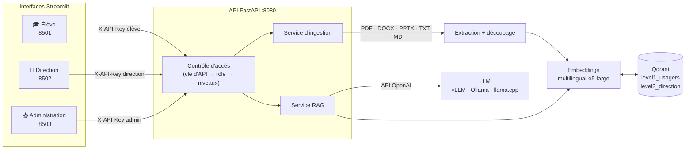

# Architecture et choix techniques

## Vue d'ensemble

## Parcours d'une question

1. L'interface envoie la question et l'historique récent à `POST /chat/stream` avec sa clé d'API.
2. L'API résout le **rôle** à partir de la clé, puis les **niveaux autorisés** (un élève : niveau 1 ;
   la direction : niveaux 1 et 2). Une demande explicite d'un niveau interdit renvoie une erreur 403.
3. La question est encodée avec le préfixe `query: ` (exigé par les modèles E5).
4. Qdrant renvoie les `top_k` passages les plus proches **uniquement dans les collections autorisées**,
   avec un seuil de similarité minimal (`min_score`).
5. Si aucun passage ne dépasse le seuil, l'API répond directement « information introuvable »
   **sans appeler le LLM** : c'est la meilleure protection contre les hallucinations.
6. Sinon, les passages sont numérotés `[1]`, `[2]`… dans le prompt système, et le LLM doit citer
   ces numéros. Les sources (document, page, score, extrait) sont envoyées à l'interface avant le texte.
7. La réponse est diffusée token par token au format NDJSON.

## Parcours d'un document

1. L'administrateur envoie un fichier avec son niveau (`POST /documents`).
2. Le nom est assaini (aucun chemin n'est accepté) et sert d'identifiant stable ; le contenu est haché (SHA-256).
3. **Même empreinte que la version stockée** → rien n'est fait (`unchanged`).
   **Empreinte différente** → l'ancienne version est supprimée puis remplacée (`updated`).
4. Le texte est extrait page par page (PDF), diapositive par diapositive (PPTX) ou d'un bloc (DOCX, TXT, MD),
   puis découpé récursivement (paragraphes → lignes → phrases → mots) en morceaux d'environ 1 200 caractères
   avec 200 caractères de chevauchement.
5. Chaque morceau est encodé avec le préfixe `passage: ` puis stocké avec ses métadonnées
   (document, page, niveau, date d'ingestion). Les identifiants de points sont déterministes (UUID v5).

## Pourquoi ces choix ?

| Choix | Raison |
|---|---|
| **Une collection Qdrant par niveau** | L'isolation est structurelle : la requête d'un élève ne touche physiquement jamais les documents internes. Un simple filtre de métadonnées pourrait être oublié ou contourné par un bug. |
| **Clé d'API par rôle** | Simple à déployer dans un établissement, sans annuaire. L'interface est découplée de l'API : on peut brancher une authentification SSO/ENT plus tard sans toucher au moteur RAG. |
| **multilingual-e5-large** | Excellent en français, open source, exécutable localement. Les préfixes `query:` / `passage:` sont gérés au même endroit pour éviter toute erreur. |
| **API OpenAI générique** | Aucun verrouillage : vLLM en production GPU, Ollama ou llama.cpp sur un poste sans GPU, ou une API distante. |
| **Ingestion idempotente** | Ré-importer un dossier complet ne crée aucun doublon et ne recalcule que ce qui a changé. |
| **Pas d'appel LLM sans contexte** | Réduit les coûts et supprime le risque d'hallucination quand l'information n'existe pas. |
| **Faux modèles dans les tests** | La suite de tests tourne en une seconde, sans GPU ni téléchargement, avec un Qdrant en mémoire : elle est exécutée à chaque push par GitHub Actions. |

## Limites connues et pistes

- Les PDF scannés (images) ne sont pas lus : il faudrait ajouter un OCR (Tesseract ou Docling).
- La recherche est purement sémantique : une recherche hybride (BM25 + vecteurs) et un re-ranker
  amélioreraient les questions contenant des noms propres ou des codes.
- L'authentification par clé partagée convient à un pilote ; un déploiement réel passerait par le SSO de l'ENT.
